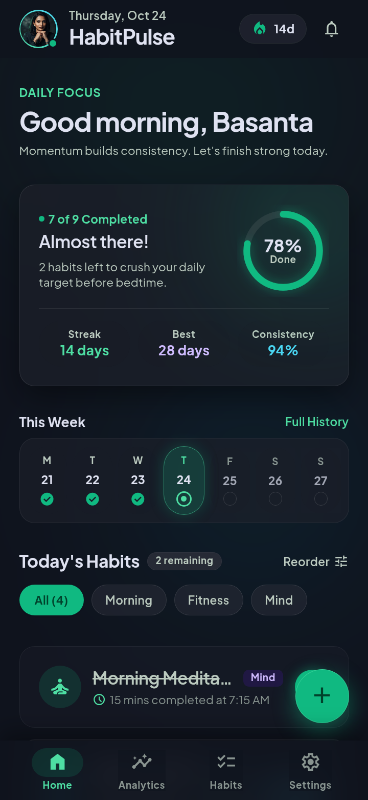

# HabitPulse

> **Modern daily habit & momentum tracker** built with Flutter & Dart.

[](https://flutter.dev)
[](https://dart.dev)
[](LICENSE)

---

## Features

- **Daily Habit Dashboard:** Track daily completions, current streaks, and weekly consistency rings.
- **Visual Progress:** Clean circular completion charts and weekly momentum indicators.
- **Categorization:** Organize habits across Mind, Body, Craft, and Lifestyle.
- **Analytics & History:** Visual breakdowns of completion rates and streak continuity over time.
- **Fluid Dark UI:** Beautiful modern dark aesthetic inspired by Material 3.

---

## Preview



---

## Project Structure

```
lib/
├── main.dart
├── models/
│   └── habit.dart               # Habit model, streak calculations, completions
├── screens/
│   ├── home_screen.dart         # Main daily overview & rings
│   ├── habits_screen.dart       # Habit management & list
│   ├── analytics_screen.dart    # Momentum charts & statistics
│   └── settings_screen.dart     # App settings & preferences
├── services/
│   └── habit_store.dart         # In-memory / persistent habit state store
├── theme/
│   └── app_theme.dart           # Custom Material 3 dark palette
└── widgets/
    ├── habit_card.dart          # Interactive habit item card
    ├── progress_ring.dart       # Circular day progress
    ├── weekly_streak_bar.dart   # 7-day completion dots
    └── add_habit_sheet.dart     # Modal sheet to create habits
```

---

## Getting Started

### Prerequisites

- Flutter SDK `^3.5.0`
- Android Studio / VS Code with Flutter extension

### Run Locally

```bash
# Clone the repository
git clone https://github.com/locus-basanta/habitpulse.git
cd habitpulse

# Get dependencies
flutter pub get

# Run on connected device or emulator
flutter run
```

---

## License

MIT © 2026 Basanta Sapkota
